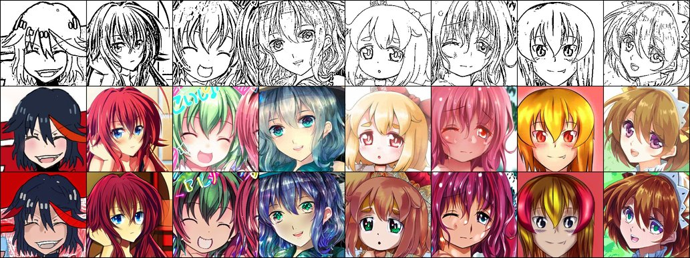
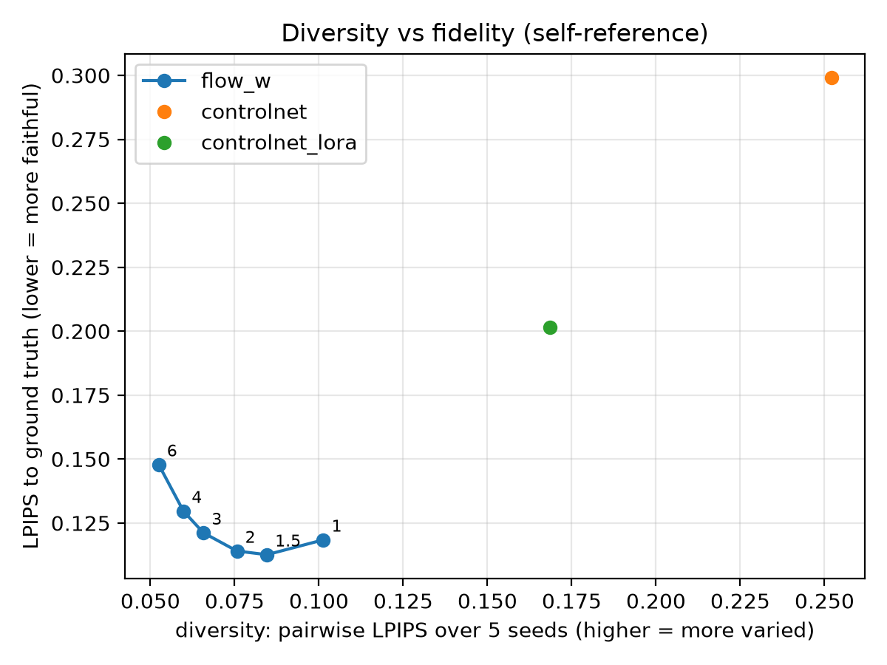

# Checkpoint 2: Model C and the evaluation pipeline

IT5413, Generative Models for Computer Vision · Group 5 · Reference-Based Anime Line-Art Colorization
Part reported: Model C (SD1.5 + ControlNet + IP-Adapter) and the shared evaluation pipeline
Author: Nguyễn Hà Phú Thịnh · 29 Nov 2026 · code at branch `feat/nhpthinh`, commit `d260494`

Every number below comes from a CSV in `results/` (file given with each table). All test numbers are over the
full test set with 5 fixed seeds (`SEEDS = [0,1,2,3,4]`). All tuning was done on `val`, never on `test`.

## 1. Summary

- **Done:** Model C runs end to end on Kaggle (T4). Zero-shot test outputs exist for all three modes (self_ref,
  cross_ref, shuffled_ref) and are scored. A rank-8 LoRA fine-tune (Experiment 4) trained for 6,000 steps, and its
  self_ref outputs are scored. The scorer passed two sanity checks (ground truth vs itself, VAE ceiling).
- **Main result:** zero-shot Model C scores low: **PSNR 11.71 dB, MS-SSIM 0.567** (self_ref). The LoRA raises these
  to **16.05 dB and 0.755**. Both are far below AnimeDiffusion (25.47 dB, 0.960).
- **Against Model B (same scorer, same test set):** B is better than C on every fidelity and realism metric in
  every mode. C is 2–3 times more diverse. No Model C setting run so far reaches B's fidelity (section 5.4).
- **Not done:** the λ sweep for RQ1 (Experiment 2) and the LoRA outputs for cross_ref and shuffled_ref are running
  on Kaggle. Not started: the steps sweep for RQ2 (Experiment 3) for C, the user study, and a second (anime) base
  model for tuning.
- **Late:** the Week-1 milestone (1 Nov) planned a first Model C run. The first run on Kaggle was on 24 Nov.

## 2. Status against the Checkpoint 1 plan

| Planned item (Checkpoint 1) | Status | Evidence |
| --- | --- | --- |
| Model C zero-shot pipeline | Done | `src/models/controlnet/`, 69 unit tests pass |
| Measure speed on T4 | Done | 2.45 s/image (zero-shot), 2.37 s/image (LoRA); 10 steps + CFG = 20 network evaluations (NFE); `results/speed.csv` |
| Tune Model C on val | Partly done | SD1.5 base only; the anime base model is not tried |
| Test outputs, 3 modes × 5 seeds | Done (zero-shot) | `results/controlnet_{self_ref,cross_ref,shuffled_ref}.csv` |
| LoRA fine-tune (Exp 4) | Training done, self_ref scored | `results/controlnet_lora_{self_ref,train_log}.csv` |
| LoRA on cross_ref / shuffled_ref | Running (Kaggle, started 28 Nov) | |
| Evaluation code (all metrics) | Done | `scripts/evaluate.py`, `src/metrics/` |
| Scorer sanity checks | Done | `results/{gt,vae_ceiling}_self_ref.csv` |
| Exp 1 table across models (shared scorer) | Done for B and C | `scripts/make_results_table.py`; section 5.4 |
| Exp 2 (λ sweep) for C | Running (Kaggle, started 28 Nov): λ ∈ {0.2, 0.4, 0.8, 1.0} | |
| Exp 3 (steps sweep) for C | Not started | |
| User study (30 cases, 10+ raters) | Code ready, not run | `scripts/build_user_study.py` |

## 3. Pipeline

**Model C.** SD1.5 with ControlNet 1.1 line-art-anime (`lllyasviel/control_v11p_sd15s2_lineart_anime`) for the
lines and IP-Adapter Plus (`h94/IP-Adapter`, CLIP image tokens) for the reference colors. It uses a fixed generic
prompt, DPM-Solver++ sampling, fp16 and CLIP skip 2. Inputs are upscaled 256 → 512 and outputs downscaled
512 → 256, with the same resize for every image. This is the one exception to the 256 × 256 rule, agreed at
Checkpoint 1.

**LoRA (Experiment 4).** A rank-8 LoRA on the U-Net attention projections (`to_q/k/v/out.0`, 1.59 M trainable
parameters) uses an epsilon-prediction loss at 512 px. ControlNet and IP-Adapter stay frozen inside the training
loop, so the LoRA learns under the same conditioning used at test time. The training data is the `train` split
with randomly warped references (thin-plate-spline warp, flip, crop). Settings: learning rate 1e-4, effective batch
8, 6,000 steps (about 0.5 epoch of 98,123 pairs), 5 % reference dropout so that classifier-free guidance still
works. The IP-Adapter Plus resampler is excluded from the LoRA so the reference encoder stays frozen.

**Evaluation.** `scripts/evaluate.py` reads only the PNGs in `outputs/<model>/<mode>/` and never imports model
code, so every model goes through the same scorer.

| Metric | Modes | Notes |
| --- | --- | --- |
| PSNR, SSIM, MS-SSIM, LPIPS to ground truth (GT) | self_ref only | cross_ref has no GT |
| FID, KID, FD-DINOv2 | all | per seed: 579 outputs vs 579 GT images; reported as mean ± std over the 5 seeds |
| Diversity | all | mean pairwise LPIPS between the 5 seeds of the same input |
| Edge-F1 | all | Canny edges of the output vs the sketch, 2 px tolerance. It checks that "diversity" does not come from ignoring the lines |
| Lab color distance, CLIP similarity | cross_ref | the face/hair mask is still a placeholder (see section 6) |

**Fairness rules in code:** fixed splits committed to the repo; seeds set in one place; deterministic warped
references for self_ref; one sketch clean-up for every model; no test data used for any choice.

## 4. Development log, including failures

| Run (date) | Outcome | Cause, and what changed |
| --- | --- | --- |
| v1 (24 Nov) | Crashed | diffusers' `clip_skip` breaks on transformers 5. CLIP skip is now applied in our own code (`9e254e0`) |
| v2 (24 Nov) | Ran; lines followed (edge-F1 ≈ 0.8), but **colors ignored the reference** | Diagnosed in v5 (next row) |
| v5 (24 Nov) | **Color match with the own reference at chance level** | diffusers 0.42 repeats the IP-Adapter embeddings by the batch size, so each output mixed the references of the whole batch. Fixed, with a regression test that runs the real pipeline (`3982f2c`) |
| v6 (24 Nov) | Fix confirmed on 8 val images | Batch leak ≈ 0.003–0.006. Own-reference color match 0.50 (base) / 0.75 (Plus) vs 0.125 chance (`results/check_controlnet.csv`) |
| v7 (25 Nov, 603 min) | Tuning + all 3 test modes scored | **Low scores**, see section 5.3 |
| v9 (26 Nov) | Sanity checks done; **LoRA crashed at step 0** | peft refuses to add a LoRA when Kaggle's old torchao 0.10 is installed. The notebook now uninstalls torchao (`1056c65`) |
| v10 (26–27 Nov, 515 min) | LoRA trained to 6,000 steps; self_ref scored | `d260494` |

The bug in v2/v5 would have made every reference-based number wrong without raising an error. It was only found
because of a dedicated check (`scripts/check_controlnet.py`). That check now runs before each long run.

## 5. Results

### 5.1 Is the scorer correct?

| Run (self_ref, 579 images) | PSNR | SSIM | MS-SSIM | LPIPS | FID | FD-DINOv2 | Edge-F1 |
| --- | --- | --- | --- | --- | --- | --- | --- |
| GT vs GT | 100 | 1.000 | 1.000 | 0.000 | ≈ 0 | ≈ 0 | 0.895 |
| VAE ceiling (GT → SD-VAE → decode) | 26.46 | 0.861 | 0.969 | 0.034 | 12.1 | 74.1 | 0.884 |

Source: `results/{gt,vae_ceiling}_self_ref.csv`. GT vs GT gives the expected limits. The edge-F1 of GT itself is
0.895, so this is the realistic maximum for that metric, not 1.0. The VAE ceiling is above AnimeDiffusion's
numbers, so latent models are not blocked from reaching them by the VAE. This ceiling is measured at 256 px; Model C
works at 512 px, so it is only an approximate ceiling for Model C.

### 5.2 Tuning on val

Coordinate search over 13 settings on 200 val images, seed 0, selected by LPIPS (`results/tune_controlnet.csv`).
Selected: IP-Adapter **Plus**, scale λ = 0.6, ControlNet scale 1.0, CFG 3.0, **10 steps** (val LPIPS 0.303).
The choice of adapter matters most (Plus 0.328 vs base 0.419). Differences between the final candidates are
small (10 steps: 0.303, 20 steps: 0.310) and were not tested for significance.

### 5.3 Test results

Self-reference (test, 579 images × 5 seeds):

| Model | PSNR ↑ | SSIM ↑ | MS-SSIM ↑ | LPIPS ↓ | FID ↓ | KID ↓ | FD-DINOv2 ↓ | Diversity | Edge P / R / F1 |
| --- | --- | --- | --- | --- | --- | --- | --- | --- | --- |
| C zero-shot | 11.71 | 0.540 | 0.567 | 0.299 | 53.1 ± 0.8 | 0.027 ± 0.001 | 221 ± 9 | 0.252 | 0.837 / 0.940 / 0.883 |
| C + LoRA | 16.05 | 0.704 | 0.755 | 0.201 | 51.5 ± 1.1 | 0.029 ± 0.002 | 168 ± 3 | 0.169 | 0.944 / 0.797 / 0.859 |
| AnimeDiffusion (reported) | 25.47 | – | 0.960 | – | 44.19* | – | – | – | – |

Zero-shot, other modes:

| Mode | Test set | FID ↓ | FD-DINOv2 ↓ | Diversity | Edge-F1 | Lab dist ↓ | CLIP sim ↑ |
| --- | --- | --- | --- | --- | --- | --- | --- |
| shuffled_ref | 579 images, references shuffled | 57.9 ± 1.5 | 252 ± 10 | 0.273 | 0.875 | – | – |
| cross_ref | 600 images, 40 held-out characters | 71.9 ± 1.4 | 366 ± 17 | 0.354 | 0.841 | 0.703 | 0.814 |

Sources: `results/controlnet_*.csv`, `results/controlnet_lora_self_ref.csv`. *AnimeDiffusion's FID uses shuffled
references, so it compares with our shuffled_ref row (57.9), not the self_ref rows. Test sets also differ; see
section 6.

**Why zero-shot Model C scores low.** On the val grid below, zero-shot outputs are much darker than the GT (mean
RGB 0.58 / 0.37 / 0.38 vs 0.74 / 0.58 / 0.53, 8 images). They add their own shading, and some miss the hair color
(5th column: blond reference, brown output). We checked that the metric code is not the cause (section 5.1).
PSNR punishes a global brightness shift heavily, which explains most of the gap. Edge recall of 0.940 is above
GT's own 0.857: zero-shot outputs draw the sketch lines more strongly than real colored images show them.

**What the LoRA changed.**
- Every self_ref fidelity metric improved (PSNR +4.3 dB, LPIPS −0.10), and FD-DINOv2 dropped from 221 to 168,
  more than 5 std apart.
- FID (53.1 → 51.5) and KID (0.027 → 0.029) moved in opposite directions, each by less than 2 std. **We claim no
  change in FID or KID.**
- Edge precision rose to 0.944, the same as GT's 0.946 (fewer edges the sketch does not have). Recall dropped to
  0.797, below GT's 0.857: some sketch lines are now lost. Edge-F1 therefore fell slightly (0.883 → 0.859).
- Diversity fell by a third (0.252 → 0.169). This is the fidelity-versus-diversity trade-off that RQ1 asks
  about; one model pair is not enough to answer RQ1.
- The training loss flattened early (mean of the first 1,000 steps 0.106, last 1,000 steps 0.101), so more steps
  are unlikely to help much.

A check of the LoRA at step 316 (4 val images, the only one run so far) still followed its own reference (color
match 4/4, chance 1/4) without batch leakage (`results/figures/check_controlnet_lora_probe.jpg`). This check has
**not** been repeated on the final 6,000-step LoRA.

### 5.4 Model C against Model B (Experiment 4, RQ3)

Model B (latent flow matching, trained from scratch by Nguyễn Công Thành) was scored with the same
`scripts/evaluate.py` on the same test set. Its VAE ceiling run gives exactly our numbers, which confirms the same
test images and scorer. Default settings for B: 32 Euler steps, CFG w = 2.0. Sources: `results/flow_*.csv`.

| Mode | Model | PSNR ↑ | MS-SSIM ↑ | LPIPS ↓ | FID ↓ | FD-DINOv2 ↓ | Diversity | Edge-F1 |
| --- | --- | --- | --- | --- | --- | --- | --- | --- |
| self_ref | B | **20.38** | **0.881** | **0.114** | **24.3 ± 0.3** | 170 ± 3 | 0.076 | 0.877 |
| self_ref | C zero-shot | 11.71 | 0.567 | 0.299 | 53.1 ± 0.8 | 221 ± 9 | 0.252 | 0.883 |
| self_ref | C + LoRA | 16.05 | 0.755 | 0.201 | 51.5 ± 1.1 | 168 ± 3 | 0.169 | 0.859 |
| shuffled_ref | B | – | – | – | **36.9 ± 0.7** | 267 ± 4 | 0.116 | 0.873 |
| shuffled_ref | C zero-shot | – | – | – | 57.9 ± 1.5 | **252 ± 10** | 0.273 | 0.875 |
| cross_ref | B | – | – | – | **62.2 ± 1.3** | 399 ± 6 | 0.133 | 0.796 |
| cross_ref | C zero-shot | – | – | – | 71.9 ± 1.4 | **366 ± 17** | 0.354 | 0.841 |

In cross_ref, B also matches the reference colors better (Lab distance 0.557 vs 0.703, CLIP similarity 0.842 vs
0.814; the Lab mask is a placeholder, see section 6).

- **RQ3, so far:** the ~111 M model trained on our data (B) beats the pretrained ~1.2 B system (C), zero-shot and
  with LoRA, on PSNR, MS-SSIM, LPIPS and FID. It does not win on every metric: C has a lower FD-DINOv2 in
  shuffled_ref and cross_ref (by about 1–2 std, so weak evidence), and C + LoRA ties B on self_ref FD-DINOv2. The systems also differ in size,
  resolution and reference encoder, so this does not show that task data alone causes the gap.
- **RQ1, so far:** RQ1 compares diversity *at equal fidelity*. B's CFG sweep (w = 1 … 6) covers LPIPS 0.113–0.148;
  both C points lie at 0.20–0.30. There is no overlap yet, so RQ1 cannot be answered from these runs. The λ sweep
  (running) tests whether any C setting reaches B's fidelity range.

## 6. Limitations and threats to validity

1. **Our test set is not the official AnimeDiffusion test set.** We have not received the official data. `test`
   is 579 random originals from the public Hugging Face mirror (fixed seed). Comparisons with AnimeDiffusion's
   numbers are only indicative until the official split arrives.
2. **Sketch clean-up differs from prior work.** All our sketches go through one binarization step (agreed by the
   team), which AnimeDiffusion does not use.
3. **FID on 579 images is biased upward.** The ± values cover only seed-to-seed variation, not test-set sampling.
   KID is reported because it is unbiased at this size.
4. **self_ref is an easy setting:** the reference is a warped copy of the GT. cross_ref is the realistic case, and
   there we only have zero-shot numbers.
5. **The LoRA was not tuned for itself.** It uses the sampling settings tuned for zero-shot. It was trained for a
   fixed number of steps with no checkpoint selection on val, so no test leakage, but possibly not its best setting.
6. **Lab color distance uses a placeholder mask** (pixels that differ from the border color). The real face/hair
   mask is not decided; cross_ref color numbers are provisional.
7. **RQ3 compares whole systems.** Models B and C differ in size, resolution and reference encoder, not only in
   training data.

## 7. Compute used (Model C, Kaggle T4)

v7 10.1 h, v9 0.2 h, v10 8.6 h, smoke runs v1–v6 about 1–2 h: **≈ 20–21 GPU-hours of the 27 h planned for C**.
Sampling one test mode for 5 seeds takes about 2 h. The two runs started on 28 Nov need about 5 h + 9 h, which
goes past C's plan; the extra comes from the shared sampling pool.

## 8. Next plan (to 13 Dec, experiments complete)

| When | Task | Exit criterion |
| --- | --- | --- |
| Running (28 Nov) | LoRA on shuffled_ref + cross_ref (~4 h GPU); reference check on the final LoRA vs zero-shot | Experiment 4 complete in all modes; shuffled_ref FID comparable with 44.19 |
| Running (28 Nov) | Experiment 2: λ ∈ {0.2, 0.4, 0.8, 1.0} for C, self_ref (λ = 0.6 exists) | Diversity-vs-fidelity curve for C next to B's (RQ1), edge-F1 next to it |
| 30 Nov – 6 Dec | Add Model A to the Experiment 1 table once its outputs exist | One table for A / B / C, same scorer, same test set |
| 3 – 6 Dec | Decide the face/hair mask; rescore cross_ref color distance | Mask method fixed and documented |
| 7 – 13 Dec | Experiment 3: steps {1, 2, 4, 8, 16, 32, 50} on a 100-image subset shared with Model B | Quality vs s/image plot (RQ2) |
| 7 – 13 Dec | User study: 30 cross_ref cases, 10+ raters | Mean rank + Friedman test |
| If budget allows | Anime SD1.5 base, selected on val | – |

Budget risk: C's planned 27 GPU-hours are used up by the two running jobs. Experiment 3 and the anime base model
(about 4 h + 3 h) come from the shared sampling pool (20 h planned).
