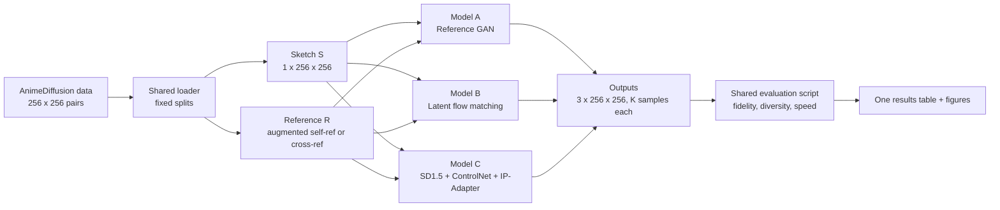
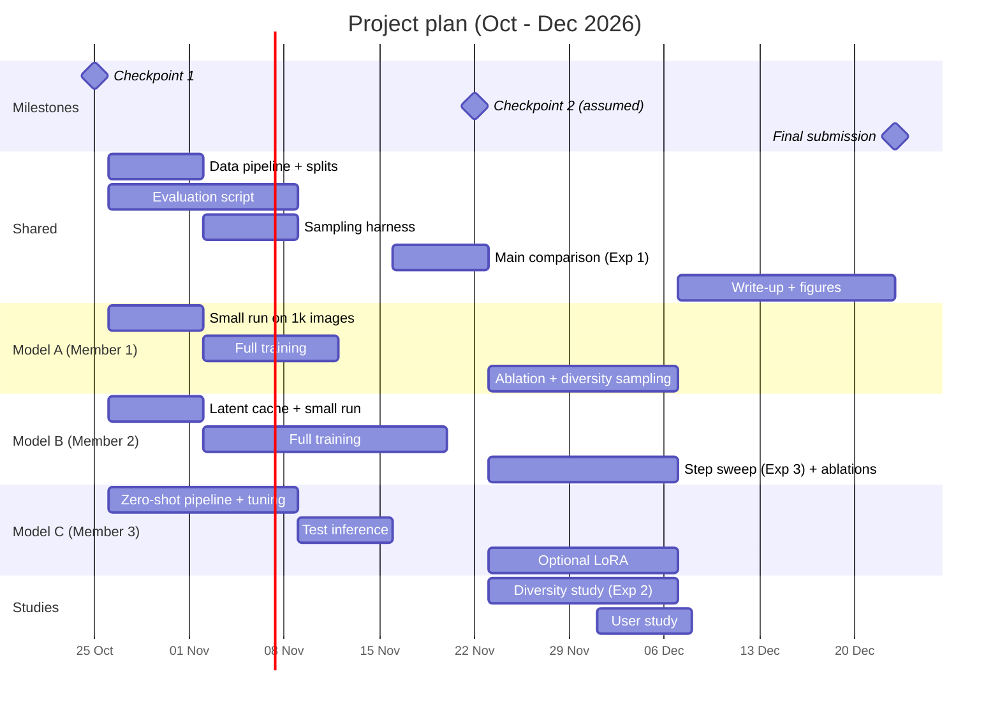

# Reference-Based Anime Line-Art Colorization

Oct 23, 2026 · @hydrochii

A controlled comparison of a GAN, a diffusion model trained from scratch, and a large pretrained diffusion model on the same task, data and metrics.

## At a glance

| Item | Decision |
| --- | --- |
| Task | Reference-based colorization: line-art sketch + color reference image → colored anime face |
| Course topics covered | Tô màu ảnh (colorization) and image-to-image translation |
| Data | AnimeDiffusion benchmark: 31,696 train / 579 test pairs at 256 × 256 |
| Model A | Reference-conditioned pix2pix GAN, trained from scratch |
| Model B | Latent flow-matching model (rectified flow) with reference cross-attention, trained from scratch |
| Model C | Stable Diffusion 1.5 + ControlNet line-art (anime) + IP-Adapter, pretrained, zero-shot then optional LoRA |
| Main question | Given one sketch and one reference, do diffusion-type models produce more varied *and* faithful colorings than a GAN? |
| Second question | How does quality trade off against the number of sampling steps? |
| Compute | Free Kaggle GPUs only: 3 members × 2 accounts |
| Resolution | Every model is trained and evaluated at 256 × 256 |

**Status at checkpoint 1 (25 Oct 2026):** problem defined, dataset chosen and access requested, three models and a shared protocol designed, work split, timeline set. No training results yet.

## 1. Problem statement

Coloring line art by hand is one of the slowest steps in anime and manga production. Artists already have a character's color design sheet, so the practical task is: **given a new line drawing and a colored reference image of the same character, color the drawing so it matches the reference.**

### Task definition

Input: a grayscale line-art sketch S (1 × 256 × 256) and a color reference image R (3 × 256 × 256) of the same character in a different pose or framing. Output: a color image Ŷ (3 × 256 × 256) that keeps every line of S and takes its colors from R.

```latex
\hat{Y} = G_\theta(S, R, z), \quad z \sim p(z)
```

The noise z matters: a GAN mostly ignores it, while diffusion and flow models are built around it. This difference is what the project measures.

### Why the problem is hard

- **Ill-posed:** many colorings fit one sketch; a model that predicts the average color produces dull, brownish results.
- **Correspondence:** the reference is not aligned with the sketch. The model must find which region of R (hair, eyes, clothing) matches which region of S.
- **Small details:** eyes and accessories are tiny but carry most of a character's identity, including heterochromatic eyes.
- **No ground truth for real use:** when the reference shows a different image, there is no single correct answer to compare against.

### Research questions

1. **RQ1 (main) — diversity vs fidelity.** For the same sketch and reference, how varied are each model's outputs, and does that diversity cost faithfulness to the sketch and reference?
2. **RQ2 — speed vs quality.** For the two diffusion-type models, how does quality change as sampling steps drop from 50 to 1?
3. **RQ3 — prior vs task data.** Does a small model trained on 31k task images beat a large general model used zero-shot or lightly fine-tuned?

## 2. Dataset

The primary dataset is the [AnimeDiffusion benchmark](https://xq-meng.github.io/projects/AnimeDiffusion/) (Cao, Meng et al., IEEE TVCG 2024): paired anime-face line drawings and colored images, 31,696 for training and 579 for testing, at 256 × 256. The authors built it because no high-resolution anime-face colorization dataset existed.

| Dataset | Role | Size | Access |
| --- | --- | --- | --- |
| [AnimeDiffusion benchmark](https://xq-meng.github.io/projects/AnimeDiffusion/) | Primary train/test | 31,696 train, 579 test, 256 × 256 | Request via the authors' Google Form (send today) |
| [AnimeFaceColorization (Hugging Face)](https://huggingface.co/datasets/ComputerVisionAnimeProject/AnimeFaceColorization) | Fallback, and extra cross-reference pairs | 8.39 GB, CC BY 4.0, folders per character | Public download |
| [Tagged Anime Illustrations, moeimouto subset (Kaggle)](https://www.kaggle.com/datasets/mylesoneill/tagged-anime-illustrations) | Source of multiple images per character | Grouped by character | Public download |

The Hugging Face dataset combines the AnimeDiffusion data (augmented with deformation flows) with the moeimouto character subset, and stores sketches and references in one folder per character. That grouping is useful for the cross-reference test below.

### Splits (fixed once, shared by all three models)

- **Train:** 30,696 pairs from the official training set.
- **Validation:** 1,000 pairs held out from the official training set, for model selection and early stopping.
- **Test:** the official 579 pairs, never used for tuning.
- Split files (`splits/train.txt`, `val.txt`, `test.txt`) are committed to the repo so every member uses identical images.

### Two test modes

| Mode | Reference given to the model | Ground truth available? | Used for |
| --- | --- | --- | --- |
| Self-reference | The test image itself, geometrically distorted (warp, flip, crop) | Yes | PSNR, SSIM, LPIPS against ground truth |
| Cross-reference | A different image of the same character | No | FID/KID, color agreement with the reference, user study |

Self-reference gives exact, repeatable numbers; cross-reference matches real use. Reporting both answers the question "but what happens with a real reference?"

### Preprocessing

- All images are 256 × 256 RGB, scaled to \[−1, 1\]. Sketches are single-channel, scaled to \[−1, 1\].
- Training references use **augmented self-reference**: the ground-truth image passed through a random thin-plate-spline warp, horizontal flip and crop. Colors stay correct, but positions no longer line up, so the model must learn correspondence instead of copying pixels.

## 3. Unified pipeline

All three models share one data loader, one set of splits, one input/output format and one evaluation script; only the model in the middle changes. This is what makes the comparison fair.



*The diagram is written in Mermaid, which GitHub renders directly in the README.*

### Consistency rules

| Rule | Value | Why |
| --- | --- | --- |
| Train/eval resolution | 256 × 256 for every model | The dataset's native size; same pixels in, same pixels out |
| Input to every model | Same sketch S and same reference R | Differences in results come from the model, not the input |
| Output format | 3 × 256 × 256 PNG, 5 samples per test input | Needed for the diversity metric |
| Random seeds | Fixed list of 5 seeds per test input | Results are reproducible |
| Test set | The same 579 images, never used for tuning | No leakage |
| Evaluation | One script, run on saved PNGs | Every model is scored by identical code |

### How the resolution question is handled

Mixing 128 px and 256 px would be unfair, because higher-resolution outputs score differently on FID and LPIPS. So all models work at 256 × 256 end to end:

- **Model A** works directly in pixel space at 256 × 256.
- **Model B** compresses 256 × 256 images to 32 × 32 × 4 latents with the frozen Stable Diffusion VAE. This is what makes training a diffusion-type model at 256 px affordable on a free GPU. Decoded outputs are 256 × 256.
- **Model C** is a Stable Diffusion 1.5 model whose native size is 512 × 512, and it produces poor images at 256. It receives the same 256 × 256 sketch upsampled to 512, and its output is downsampled back to 256 before evaluation. This is the single documented exception, applied identically to every test image.

To show that compressing to a latent space doesn't unfairly limit Model B, the evaluation also reports the **VAE reconstruction ceiling**: the best PSNR/LPIPS achievable by encoding and decoding the ground truth.

## 4. Models

The three models cover the three main families in the course: an adversarial model, a diffusion-type model trained from scratch, and a large pretrained diffusion model adapted to the task.

|  | Model A: Reference GAN | Model B: Latent flow matching | Model C: SD1.5 + ControlNet + IP-Adapter |
| --- | --- | --- | --- |
| Family | Conditional GAN | Flow matching (rectified flow) in latent space | Latent diffusion, pretrained |
| Trained on our data | Yes, from scratch | Yes, from scratch (VAE and reference encoder frozen) | No (zero-shot); optional LoRA |
| Space | Pixels, 256 × 256 | VAE latents, 32 × 32 × 4 | VAE latents, 64 × 64 × 4 (512 px) |
| How the reference enters | Concatenated with the sketch as input channels | Cross-attention on DINOv2 patch tokens | IP-Adapter cross-attention on CLIP image features |
| Source of randomness | Dropout only | Initial noise ε | Initial noise ε |
| Network evaluations per image | 1 | 1–50 (Euler steps) | 1–50 (scheduler steps) |
| Reference paper | pix2pix (Isola et al., 2017) | Flow Matching (Lipman et al., 2023); Rectified Flow (Liu et al., 2023) | ControlNet (Zhang et al., 2023); IP-Adapter (Ye et al., 2023) |

### Model A — Reference-conditioned pix2pix GAN

**Architecture.** The generator is the pix2pix U-Net (8 down/up levels with skip connections). Its input is the sketch and the warped reference stacked as 4 channels: x = \[S; R\]. The discriminator is a 70 × 70 PatchGAN that judges whether each image patch is a plausible coloring of the sketch, taking \[S; Y\] as input.

**Losses.**

```latex
\mathcal{L}_G = \mathcal{L}_{\text{GAN}}(G, D) + \lambda_{1}\,\lVert Y - G(S,R) \rVert_1 + \lambda_{p} \sum_{l} \lVert \phi_l(Y) - \phi_l(G(S,R)) \rVert_1
```

Here φ\_l are VGG-19 feature maps (perceptual loss). Starting values: λ₁ = 100 as in pix2pix, λ\_p = 10, least-squares GAN loss for stability.

**Training.** Adam, learning rate 2 × 10⁻⁴, β = (0.5, 0.999), batch size 16, mixed precision, about 30 epochs, with the official [pytorch-CycleGAN-and-pix2pix](https://github.com/junyanz/pytorch-CycleGAN-and-pix2pix) code as the starting point.

**Role in the study.** pix2pix gets randomness only from dropout, and its authors noted the outputs vary very little. For RQ1 we sample it with dropout kept on at test time, which is the fairest way to ask a GAN for several outputs.

**Stretch goal.** Replace channel concatenation with an attention module between sketch and reference features, as in SCFT (Lee et al., CVPR 2020).

### Model B — Latent flow matching with reference cross-attention

Flow matching is the training objective behind recent models such as Stable Diffusion 3. It learns a velocity field that moves noise to data along nearly straight paths, which is why it can sample in few steps. This makes it a natural fit for RQ2.

**Encoders (frozen).**

- Image and sketch: the Stable Diffusion VAE ([`stabilityai/sd-vae-ft-mse`](https://huggingface.co/stabilityai/sd-vae-ft-mse)) maps 256 × 256 to 32 × 32 × 4: z₁ = E(Y), z\_S = E(S).
- Reference: DINOv2 ViT-S/14 turns R into 256 patch tokens of 384 dimensions, c\_R. DINOv2 features match semantic parts (hair, eyes) across poses, which is what correspondence needs.

**Network.** A `diffusers` `UNet2DConditionModel` with 8 input channels (noisy latent + sketch latent), 4 output channels and cross-attention on c\_R, roughly 100M parameters.

**Training objective (rectified flow).** With noise ε \~ N(0, I) and time t ∈ \[0, 1\]:

```latex
x_t = (1 - t)\,\varepsilon + t\,z_1, \qquad
\mathcal{L}_{\text{FM}} = \mathbb{E}_{t,\varepsilon,(z_1,z_S,c_R)}\left\lVert v_\theta(x_t, t, z_S, c_R) - (z_1 - \varepsilon) \right\rVert_2^2
```

t is drawn from a logit-normal distribution, which puts more training on the middle of the path, following Stable Diffusion 3.

**Classifier-free guidance.** During training c\_R is replaced by a learned null token with probability 0.1. At sampling time:

```latex
\tilde{v} = v_\theta(x_t, t, z_S, \varnothing) + w\,\big(v_\theta(x_t, t, z_S, c_R) - v_\theta(x_t, t, z_S, \varnothing)\big)
```

The guidance weight w controls how strongly colors follow the reference.

**Sampling.** Euler integration of dx/dt = ṽ from t = 0 to 1 in N ∈ {1, 2, 4, 8, 16, 32, 50} steps, then decoding with the VAE. Different seeds for ε give different colorings.

**Training setup.** Sketch and target latents are computed once and cached (about 0.5 GB in fp16), so each step skips the VAE. AdamW, learning rate 1 × 10⁻⁴, batch size 64, EMA of weights (decay 0.9999), fp16 mixed precision.

**Stretch goal.** Swap the U-Net for a small Diffusion Transformer (DiT) with the same inputs, to compare backbones.

### Model C — Stable Diffusion 1.5 + ControlNet line-art + IP-Adapter

This model asks whether a large general model, steered by adapters, can do the task without being trained on it.

**Components (all from Hugging Face, loaded with `diffusers`).**

- Base: a Stable Diffusion 1.5 checkpoint. The ControlNet 1.1 line-art-anime model was designed for anime-style SD1.5 bases, so one anime base and the original SD1.5 are both tried and the better one on the validation set is kept.
- Structure: [`lllyasviel/control_v11p_sd15s2_lineart_anime`](https://huggingface.co/lllyasviel/control_v11p_sd15s2_lineart_anime), which takes the sketch and keeps the output on its lines.
- Colors: [IP-Adapter](https://huggingface.co/h94/IP-Adapter) (`ip-adapter_sd15`), which injects the reference image through extra cross-attention layers. `diffusers` supports combining IP-Adapter with ControlNet.

**How the conditions combine.** IP-Adapter adds a second, decoupled cross-attention for image features beside the text cross-attention:

```latex
Z = \mathrm{Attn}(Q, K_{\text{text}}, V_{\text{text}}) + \lambda\,\mathrm{Attn}(Q, K_{\text{img}}, V_{\text{img}})
```

The ControlNet adds sketch features to the U-Net's skip connections, scaled by a conditioning weight.

**Settings tuned on the validation set.** IP-Adapter scale λ, ControlNet scale, guidance scale, number of steps, and one fixed generic prompt (e.g. "anime character face, flat colors, best quality") with a fixed negative prompt.

**Optional fine-tuning.** A rank-8 LoRA on the U-Net attention layers using the training pairs at 512 px, fp16 and gradient checkpointing. This turns RQ3 into a three-way comparison: zero-shot vs LoRA vs trained from scratch.

## 5. Evaluation and experiments

Every model is judged on four things: fidelity to the ground truth, realism, faithfulness to the reference, and diversity. Speed is reported alongside, and one shared script computes everything from saved PNGs.

### Metrics

| Metric | Measures | Test mode | Better |
| --- | --- | --- | --- |
| PSNR, SSIM | Pixel and structure agreement with ground truth | Self-reference | Higher |
| LPIPS (to ground truth) | Perceptual distance to ground truth | Self-reference | Lower |
| FID (Inception) | Realism of the output distribution | Both | Lower |
| KID | Same as FID, but unbiased for small sets like 579 images | Both | Lower |
| FD-DINOv2 | FID computed with DINOv2 features, which represent non-photo images better than Inception | Both | Lower |
| Reference color distance | Distance between color histograms (in Lab space) of output and reference, inside a face/hair mask | Cross-reference | Lower |
| CLIP image similarity | Semantic agreement between output and reference | Cross-reference | Higher |
| Diversity (pairwise LPIPS) | Mean LPIPS between the 5 samples made for the same sketch and reference | Both | Higher = more varied |
| Speed | Seconds per image on a Kaggle T4, and network evaluations per image | — | Lower |
| User preference | Blind ranking of the three outputs by 10+ people on 30 test cases | Cross-reference | Higher |

For diversity, the K = 5 samples come from 5 fixed seeds, the same seeds for every model.

### Experiment 1 — Main comparison (all models)

One table with every metric above for A, B (best setting) and C (best setting), on the 579 test images in both test modes. A figure shows the three outputs side by side for 8 test cases.

### Experiment 2 — Diversity vs fidelity (RQ1, main question)

- Plot each model as a point: x = diversity (pairwise LPIPS), y = fidelity (LPIPS to ground truth, self-reference mode).
- For Models B and C, trace a curve by sweeping the guidance weight w (B) or the IP-Adapter scale λ (C). Higher guidance should raise fidelity and lower diversity.
- **Hypothesis:** A clusters at near-zero diversity; B and C reach higher diversity at similar fidelity. If the hypothesis fails, report it; a clear negative result is still a result.
- **Sanity check:** diversity must stay inside the sketch's lines. Measure the change of edges between output and sketch (edge-map F1), so a model can't look "diverse" by ignoring the sketch.

### Experiment 3 — Speed vs quality (RQ2)

- Model B: N ∈ {1, 2, 4, 8, 16, 32, 50} Euler steps.
- Model C: the same step counts with a DPM-Solver++ scheduler.
- Plot FD-DINOv2 and LPIPS against seconds per image, with Model A as a single point (1 step).
- **Hypothesis:** flow matching degrades more gracefully at low step counts than the pretrained diffusion model.

### Experiment 4 — Prior vs task data (RQ3)

Compare Model C zero-shot, Model C + LoRA (if time allows) and Model B, trained only on task data.

### Ablations (if time allows)

| Ablation | Model | Question |
| --- | --- | --- |
| Without augmented self-reference (reference = unwarped ground truth) | A, B | Does the model just copy pixels instead of learning correspondence? |
| Guidance off (w = 1) | B | How much does classifier-free guidance help reference color agreement? |
| CLIP vs DINOv2 reference encoder | B | Which features carry color and correspondence better? |

## 6. Training environment

All training runs on free Kaggle notebooks with a single 16 GB GPU (T4 or P100). The estimated total need is about 125 GPU-hours, well under what three accounts provide over eight weeks.

**Account note:** Kaggle's terms allow one account per person, so this plan is budgeted on **3 accounts** (one per member), not 6. At roughly 30 GPU-hours per account per week (check the quota shown in each account's settings), that is about 90 GPU-hours per week for the team.

### Software

- Python 3.11, PyTorch 2.x with CUDA, mixed precision (fp16; T4 and P100 have no bf16 support).
- `diffusers`, `transformers`, `accelerate`, `peft` (LoRA), `torchmetrics` / `clean-fid`, `lpips`.
- Experiment tracking: Weights & Biases (free tier), or a CSV log per run if the team prefers.
- One `requirements.txt` and one `configs/` folder (YAML per model) in the repo, so runs are reproducible.

### Estimated GPU budget

| Work | Owner | Estimated GPU-hours |
| --- | --- | --- |
| Model A training (≈30 epochs at 256 px) | Member 1 | 15 |
| Model B latent caching | Member 2 | 2 |
| Model B training | Member 2 | 50 |
| Model C validation tuning + test inference | Member 3 | 12 |
| Model C optional LoRA | Member 3 | 15 |
| Sampling 5 × 579 outputs × step sweeps (A, B, C) | All | 20 |
| Metrics (FID, KID, LPIPS, DINOv2, CLIP) | Member 3 | 5 |
| Ablations | Members 1, 2 | 6 |
| **Total** |  | **≈125** |

These are planning estimates; the first week's short runs will replace them with measured throughput.

### Surviving session limits

Kaggle sessions stop after a time limit, so every training script must resume cleanly:

1. Save a checkpoint (model, EMA, optimizer, scaler, step, random state) every 30 minutes to `/kaggle/working`.
2. At the end of each session, save the checkpoint as a new version of a private Kaggle Dataset (or push to a private Hugging Face repo).
3. Each new session attaches that dataset and resumes from the latest step.
4. Data (images, cached latents) lives in one shared private Kaggle Dataset that all three accounts attach, so nobody downloads it twice.

## 7. Task assignment

Each member owns one model end to end (implementation, training, tuning, sampling) and one shared technical component. Nobody does only non-technical work; writing and slides are split equally.

| Role | Owns model | Shared technical component | Writing share |
| --- | --- | --- | --- |
| Member 1 | **Model A** — Reference GAN | **Data pipeline:** dataset download and private Kaggle Dataset, split files, shared `Dataset` class, augmented self-reference warp, cross-reference pair list | Problem statement, dataset, Model A sections |
| Member 2 | **Model B** — Latent flow matching | **Latent and feature caching + sampling harness:** VAE latent cache, VAE reconstruction ceiling, one `sample.py` that saves 5 seeded outputs per test input for any model | Model B section, speed vs quality study |
| Member 3 | **Model C** — SD1.5 + ControlNet + IP-Adapter | **Evaluation script:** all metrics in Section 5, one results CSV per model, plotting scripts, user-study form | Model C section, evaluation, diversity study |

### Shared interfaces (agree in week 1)

To keep the three pipelines consistent, every model implements the same small interface:

```python
class Colorizer:
    def colorize(self, sketch: Tensor, reference: Tensor, seed: int, steps: int | None = None) -> Tensor:
        """sketch: (B,1,256,256) in [-1,1]; reference: (B,3,256,256) in [-1,1]
        returns (B,3,256,256) in [-1,1]"""
```

`sample.py` calls this for every test input and seed and writes `outputs/<model>/<mode>/<image_id>_s<seed>.png`; `evaluate.py` reads only those folders.

### Working rules

- One GitHub repo, a branch per member, pull requests reviewed by one other member.
- A 30-minute team call each week: each member shows one number and one image.
- Each member writes the README section for their own model and component.

## 8. Timeline

The plan runs from checkpoint 1 (25 Oct 2026) to the final submission (about 23 Dec 2026). Checkpoint 2's date isn't fixed yet; this plan assumes around 22 Nov 2026, by which point all three models will have first test results.



### Deliverables by milestone

- **Checkpoint 1 (25 Oct):** this document; dataset access requested; repo created with this README.
- **End of week 1 (1 Nov):** shared loader and splits working; each model trains or runs on 1,000 images and produces a sample grid.
- **Checkpoint 2 (≈22 Nov):** all three models produce test outputs; first results table (Experiment 1, self-reference mode); first diversity numbers.
- **Mid-December (13 Dec):** Experiments 2 and 3 complete; cross-reference results; user study done; ablations that fit.
- **Final (≈23 Dec):** report, code, trained checkpoints, figures and README with results.

## 9. Risks and fallbacks

| Risk | Likelihood | Fallback |
| --- | --- | --- |
| AnimeDiffusion dataset access is slow (request form) | Medium | Start immediately with the public Hugging Face AnimeFaceColorization dataset, which contains the AnimeDiffusion data; switch splits when the official files arrive |
| Model B undertrains within the GPU budget | Medium | Reduce U-Net width, keep 256 px via latents; report the training curve honestly |
| Kaggle session limits interrupt training | High | Resumable checkpoints every 30 minutes (Section 6) |
| Model C ignores the reference colors | Medium | Tune IP-Adapter scale on validation; try the stronger IP-Adapter Plus variant; LoRA fine-tuning |
| Model C at 512 px is slow on T4 | Low | fp16, attention slicing, 20 steps by default; inference only on 579 test images |
| FID is unreliable on 579 images and on anime | High | Report KID and FD-DINOv2 next to FID; rely on paired metrics in self-reference mode |
| GAN training is unstable | Medium | LSGAN loss, the strong L1 term, and the official pix2pix code as a known-good base |
| A member falls behind | Medium | Weekly check-in; shared harness means any member can run another's model |

## 10. Repository structure

```text
anime-ref-colorization/
├── README.md                 # this document
├── requirements.txt
├── configs/
│   ├── gan.yaml              # Model A
│   ├── flow.yaml             # Model B
│   └── controlnet.yaml       # Model C
├── splits/                   # train.txt, val.txt, test.txt, cross_ref_pairs.csv
├── src/
│   ├── data/                 # Dataset class, reference warping (Member 1)
│   ├── models/
│   │   ├── gan/              # Model A (Member 1)
│   │   ├── flow/             # Model B (Member 2)
│   │   └── controlnet/       # Model C (Member 3)
│   ├── colorizer.py          # shared Colorizer interface
│   └── utils/                # checkpointing, logging, seeding
├── scripts/
│   ├── cache_latents.py      # Member 2
│   ├── train_gan.py
│   ├── train_flow.py
│   ├── tune_controlnet.py
│   ├── sample.py             # writes outputs/<model>/<mode>/...
│   └── evaluate.py           # Member 3: all metrics -> results/*.csv
├── notebooks/                # Kaggle entry notebooks, one per model
├── results/                  # CSV tables and figures (committed)
└── outputs/                  # generated images (not committed)
```

## 11. Anticipated questions

Short, defensible answers to the "why" questions most likely to come up at the checkpoint.

### About the problem

**Why colorization, and why anime?** It is one of the topics on the course list, and line-art coloring is a real bottleneck in animation work. Anime faces are also a good test bed: flat colors make errors easy to see, and small regions (eyes) test fine control.

**Why reference-based instead of plain sketch-to-color?** Plain colorization has no correct answer, so it's hard to evaluate. A reference defines which colors are right, which makes fidelity measurable. It is also how artists actually work, from a character color sheet.

**Why is this a generative-model problem and not just regression?** Many colorings fit one sketch. A regression model trained with L1/L2 predicts the average of them, which looks dull. Generative models can produce one specific, sharp coloring, and the project studies exactly how they handle that multiplicity (RQ1).

### About the data

**Why the AnimeDiffusion dataset?** It is a published benchmark built specifically for reference-based anime-face colorization: 31,696 training and 579 test pairs at 256 × 256, with a fixed test split used in a peer-reviewed paper (IEEE TVCG 2024). Using it means results are comparable to published work and no time goes into collecting data.

**Why not collect your own data?** Collecting and cleaning paired sketch/color images would take weeks and introduce quality problems. The project's contribution is the controlled comparison, not a new dataset.

**Why 256 × 256 for every model?** It is the dataset's native resolution, and comparing models at different resolutions is unfair for FID and LPIPS. Model B reaches 256 px affordably by working in a VAE latent space. Model C must run at 512 internally, so its input is upsampled and its output downsampled back to 256, identically for every image (Section 3).

**Why distort the reference during training?** If the reference is the unchanged ground truth, a model can simply copy pixels and learns nothing about matching regions. Warping keeps the colors but breaks the alignment, forcing the model to learn correspondence. The ablation in Section 5 tests this directly.

### About the models

**Why these three models?** They represent the three main families in the course, under one task and one protocol: an adversarial model (A), a diffusion-type model trained from scratch (B), and a large pretrained diffusion model adapted with adapters (C). Each one answers a different part of the research questions.

**Why pix2pix as the GAN?** It is the standard conditional GAN for paired image-to-image tasks, is cited on the course slides, and has an official PyTorch codebase. A well-known baseline makes the comparison credible.

**Why flow matching instead of a classic DDPM for Model B?** Flow matching is the current standard objective (used by Stable Diffusion 3). It learns straighter paths from noise to data, so it samples in far fewer steps, which is exactly what RQ2 measures. It is also simpler to implement: one regression loss on a velocity.

**Why train in latent space?** A diffusion model in pixel space at 256 px is too expensive for a free GPU. The pretrained VAE compresses each image 48-fold (256 × 256 × 3 → 32 × 32 × 4), as in Latent Diffusion. The VAE reconstruction ceiling is reported so this choice is transparent.

**Why DINOv2 for the reference encoder?** DINOv2 patch features match the same semantic part (hair, eye, collar) across different images and poses. That is exactly the correspondence the task needs. CLIP is tested as an ablation.

**Why use a pretrained model (C) at all? Isn't that unfair?** It is a deliberate comparison, not a competitor in the same category. The question is whether 31k task images beat billions of general images plus adapters (RQ3). The table always states which model is trained on what.

**Why ControlNet + IP-Adapter instead of a dedicated colorization model like MangaNinja?** Dedicated recent models are large and slow to run on a T4. ControlNet and IP-Adapter are standard, well-documented adapters that `diffusers` supports together, so the result is reproducible on free hardware.

### About evaluation

**Why not just FID?** FID needs many images (579 is small, so it's biased) and uses ImageNet photo features, which may represent anime poorly. It is reported next to KID (unbiased for small sets), FD-DINOv2, paired metrics and a user study.

**How do you measure diversity without rewarding nonsense?** Diversity (pairwise LPIPS between 5 samples) is always reported with fidelity, and with an edge-agreement check against the sketch. A model only "wins" if it is varied and faithful at the same time.

**What if your hypothesis is wrong?** Then the comparison shows it, under a fair protocol, and that is still a valid result. The goal is to measure, not to prove a model is best.

## 12. References

**Task and data**

1. Cao, Meng, Mok, Lee, Liu, Li. [AnimeDiffusion: Anime Diffusion Colorization](https://arxiv.org/abs/2303.11137). IEEE TVCG, 2024. [Project page and dataset](https://xq-meng.github.io/projects/AnimeDiffusion/).
2. Lee et al. [Reference-Based Sketch Image Colorization using Augmented-Self Reference and Dense Semantic Correspondence](https://arxiv.org/abs/2005.05207) (SCFT). CVPR, 2020.
3. Delaval, Koïta. [Anime Face Colorization Dataset](https://huggingface.co/datasets/ComputerVisionAnimeProject/AnimeFaceColorization) and [Sketch Colorization Using Diffusion Models](https://github.com/AxelDlv00/DiffusionSketchColorization) (student project, École Polytechnique / Télécom Paris), 2025.
4. Liu et al. [MangaNinja: Line Art Colorization with Precise Reference Following](https://arxiv.org/abs/2501.08332), 2025.

**Models**

5. Isola, Zhu, Zhou, Efros. [Image-to-Image Translation with Conditional Adversarial Networks](https://arxiv.org/abs/1611.07004) (pix2pix). CVPR, 2017. [Code](https://github.com/junyanz/pytorch-CycleGAN-and-pix2pix).
6. Lipman et al. [Flow Matching for Generative Modeling](https://arxiv.org/abs/2210.02747). ICLR, 2023.
7. Liu, Gong, Liu. [Flow Straight and Fast: Learning to Generate and Transfer Data with Rectified Flow](https://arxiv.org/abs/2209.03003). ICLR, 2023.
8. Esser et al. [Scaling Rectified Flow Transformers for High-Resolution Image Synthesis](https://arxiv.org/abs/2403.03206) (Stable Diffusion 3). ICML, 2024.
9. Rombach et al. [High-Resolution Image Synthesis with Latent Diffusion Models](https://arxiv.org/abs/2112.10752). CVPR, 2022.
10. Saharia et al. [Palette: Image-to-Image Diffusion Models](https://arxiv.org/abs/2111.05826). SIGGRAPH, 2022.
11. Zhang, Rao, Agrawala. [Adding Conditional Control to Text-to-Image Diffusion Models](https://arxiv.org/abs/2302.05543) (ControlNet). ICCV, 2023. [Line-art anime checkpoint](https://huggingface.co/lllyasviel/control_v11p_sd15s2_lineart_anime).
12. Ye et al. [IP-Adapter: Text Compatible Image Prompt Adapter for Text-to-Image Diffusion Models](https://arxiv.org/abs/2308.06721), 2023. [Weights](https://huggingface.co/h94/IP-Adapter); [diffusers guide](https://huggingface.co/docs/diffusers/using-diffusers/ip_adapter).
13. Oquab et al. [DINOv2: Learning Robust Visual Features without Supervision](https://arxiv.org/abs/2304.07193), 2023.
14. Ho, Salimans. [Classifier-Free Diffusion Guidance](https://arxiv.org/abs/2207.12598), 2022.

**Evaluation**

15. Heusel et al. [GANs Trained by a Two Time-Scale Update Rule Converge to a Local Nash Equilibrium](https://arxiv.org/abs/1706.08500) (FID). NeurIPS, 2017.
16. Bińkowski et al. [Demystifying MMD GANs](https://arxiv.org/abs/1801.01401) (KID). ICLR, 2018.
17. Zhang et al. [The Unreasonable Effectiveness of Deep Features as a Perceptual Metric](https://arxiv.org/abs/1801.03924) (LPIPS). CVPR, 2018.
18. Stein et al. [Exposing Flaws of Generative Model Evaluation Metrics and Their Unfair Treatment of Diffusion Models](https://arxiv.org/abs/2306.04675) (FD-DINOv2). NeurIPS, 2023.
